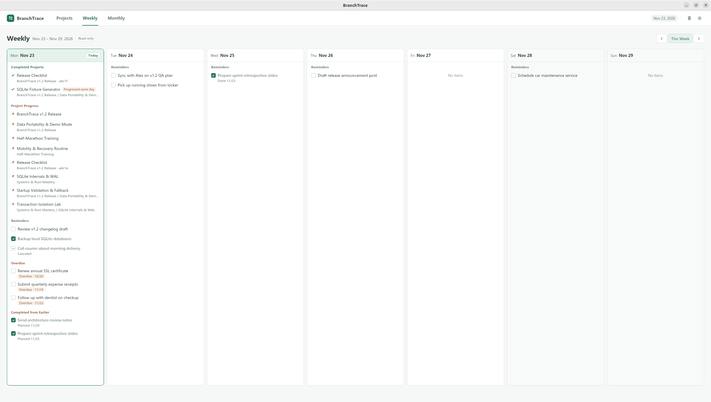
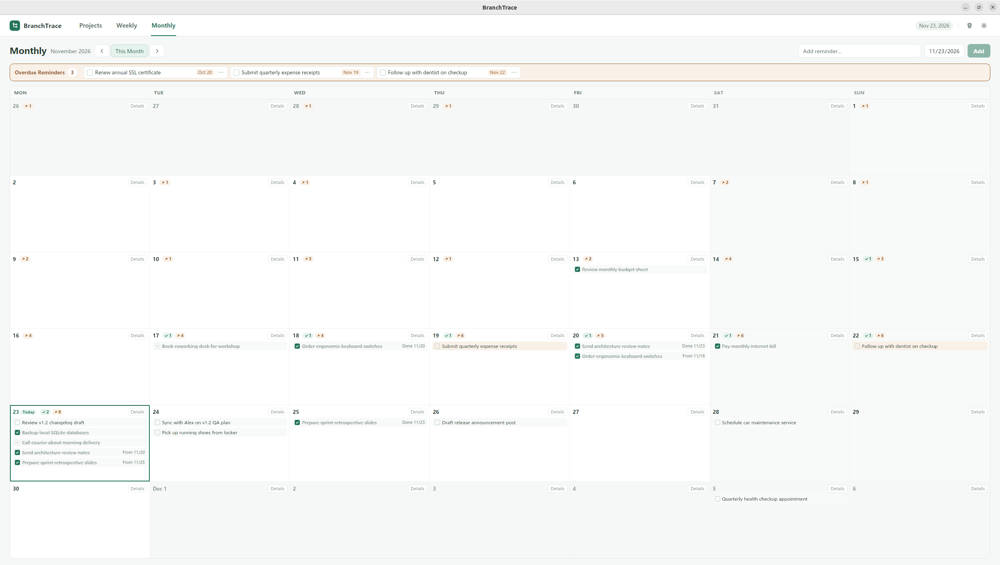

# 枝迹（BranchTrace）

枝迹是一个离线优先的树形项目管理与每日行动记录桌面应用，使用 Tauri 2、React、TypeScript、TanStack Query、Rust、rusqlite 和 SQLite。

| project-view | weekly-view | monthly-view |
| --- | --- | --- |
|  |  |  |


## 开发

```bash
pnpm install
pnpm dev
```

开发浏览器页面会使用本地演示数据（清空 `localStorage` 键 `branchtrace-mock` 即可重置回初始演示状态）；通过 Tauri 启动时，前端会调用 Rust Commands 并将 SQLite 保存到操作系统的应用数据目录。

## 演示 / 测试数据库

项目内置了一份覆盖全部功能的动态日期测试数据库生成器（不会提交 `.sqlite3` 文件到 Git，也不会影响个人正式数据库）：

```bash
# 按当前本地日期生成 demo/branchtrace-demo.sqlite3（已存在时覆盖）
pnpm db:demo

# 如需指定输出路径或固定基准日期
cargo run --manifest-path src-tauri/Cargo.toml --bin seed_demo -- \
  --output demo/branchtrace-demo.sqlite3 --today 2026-11-23 --force

# 通过 BRANCHTRACE_DB_PATH 环境变量隔离启动桌面端（不触碰正式库）
BRANCHTRACE_DB_PATH="$PWD/demo/branchtrace-demo.sqlite3" pnpm tauri dev
```

演示数据库直观涵盖以下功能场景：

- **Projects**：4 棵多领域项目树（最深 4 级）、持久化折叠分支与 `Expand All` / `Collapse All`、已完成/已取消父节点下的活跃子项目（父子状态独立）、`Log Today` / `Progressed` 切换、`+N` 多月推进历史日历，以及同名同路径项目 `Release Checklist`（在移动弹窗与周视图自动分配短 ID `a4c1e` / `a4c1f`）。
- **Weekly**：当日同时包含“同日推进并完成（`Progressed same day`）”与“仅完成”项目、同名短 ID 区分、已取消项目的历史推进保留、当日计划提醒（活跃 / 同日完成合并 / 已取消）、逾期提醒以及跨日完成提醒（延迟补完 + 提前完成）。
- **Monthly**：顶部跨月 `Overdue Reminders` 横幅、每日项目完成/推进去重徽章、点击日期打开弹窗管理与同日拖拽排序，以及点击 `Details` 精准跳转至周视图对应列。
- **Trash**：`Projects` 与 `Reminders` 双分类，包含单节点、普通子树以及**嵌套回收站批次**（`Old Mobile Companion Idea` 与更早单独删除的子节点 `Push Notification Spike`），可直接验证父节点仍在回收站时的恢复拦截与隔离恢复行为。

## 构建

```bash
pnpm build
pnpm tauri dev
pnpm tauri build
```

Linux 构建需要 Tauri 2 的系统依赖，包括 WebKitGTK、GTK 3 和 librsvg；Windows 与 macOS 请按 Tauri 2 官方前置依赖安装 Rust 和平台工具链。

## 后端结构

- `src-tauri/src/models.rs`：DTO、错误码与领域枚举。
- `src-tauri/src/db/`：唯一 SQLite 连接的数据库工作线程、迁移、事务、各领域业务操作、演示数据生成器（`demo.rs`）与测试（`tests.rs`）。
- `src-tauri/src/bin/seed_demo.rs`：生成独立演示 SQLite 文件的 CLI 工具。
- `src-tauri/src/lib.rs`：Tauri Commands、应用数据目录（含 `BRANCHTRACE_DB_PATH` 覆盖）和生命周期。
- `src-tauri/migrations/001_initial.sql`：SQLite v1 初始化迁移。

所有业务写入都经过 Rust 的状态、日期、树关系和版本校验。React 不直接访问 SQLite。

## 测试与验证

### 1. 一键全量测试（推荐）

在仓库根目录执行（如使用仓库内置 Rust 工具链，先导出 `RUSTUP_HOME`、`CARGO_HOME` 与 `PATH`）：

```bash
export RUSTUP_HOME="$PWD/.rustup" CARGO_HOME="$PWD/.cargo" PATH="$PWD/.cargo/bin:$PATH"

# 前端 TypeScript 类型检查 + 生产构建
./node_modules/.bin/tsc
./node_modules/.bin/vite build

# Node.js 回归测试（Mock API、月视图布局、树展开、移动选项、树形布局、日期格式化）
node --test tests/*.test.mjs

# Rust 代码格式检查 + 全部单元测试与 SQLite 集成测试
cargo fmt --manifest-path src-tauri/Cargo.toml --all -- --check
cargo test --manifest-path src-tauri/Cargo.toml

# 演示 / 测试数据库生成器冒烟验证
cargo run --manifest-path src-tauri/Cargo.toml --bin seed_demo -- --output demo/branchtrace-demo.sqlite3 --force
```

### 2. 按模块定向测试

```bash
# 单独运行前端 / 浏览器 Mock 回归测试
node --test tests/mock-api.test.mjs
node --test tests/monthly-layout.test.mjs
node --test tests/project-tree.test.mjs
node --test tests/project-options.test.mjs
node --test tests/project-expansion.test.mjs
node --test tests/ui-format.test.mjs

# 单独运行 Rust 测试（支持按名称过滤）
export RUSTUP_HOME="$PWD/.rustup" CARGO_HOME="$PWD/.cargo" PATH="$PWD/.cargo/bin:$PATH"
cargo test --manifest-path src-tauri/Cargo.toml demo
cargo test --manifest-path src-tauri/Cargo.toml resolve_db_path
cargo test --manifest-path src-tauri/Cargo.toml month_calendar
cargo test --manifest-path src-tauri/Cargo.toml nested_trash

# 查看 seed_demo 参数说明与固定日期生成测试
cargo run --manifest-path src-tauri/Cargo.toml --bin seed_demo -- --help
cargo run --manifest-path src-tauri/Cargo.toml --bin seed_demo -- \
  --output demo/branchtrace-demo.sqlite3 --today 2026-11-23 --force
```

前端回归测试使用 Node.js 24 内置的 TypeScript 支持，无需额外测试依赖。

核心需求与验收边界见 `docs/version1.0/01_MVP_需求规格.md`，API 契约见 `docs/version1.0/03_Rust_API_设计.md`，版本变更说明见 `docs/changelog.md`。

## 桌面窗口调试

### 使用正式数据库启动

```bash
pnpm build
RUSTUP_HOME="$PWD/.rustup" CARGO_HOME="$PWD/.cargo" \
PATH="$PWD/.cargo/bin:$PATH" \
pnpm tauri dev --no-watch --config '{"build":{"beforeDevCommand":"pnpm preview --host 127.0.0.1 --port 1420"}}'
```

### 使用测试数据库隔离启动（不触碰正式库）

```bash
export RUSTUP_HOME="$PWD/.rustup" CARGO_HOME="$PWD/.cargo" PATH="$PWD/.cargo/bin:$PATH"
pnpm db:demo
pnpm build
BRANCHTRACE_DB_PATH="$PWD/demo/branchtrace-demo.sqlite3" \
pnpm tauri dev --no-watch --config '{"build":{"beforeDevCommand":"pnpm preview --host 127.0.0.1 --port 1420"}}'
```

