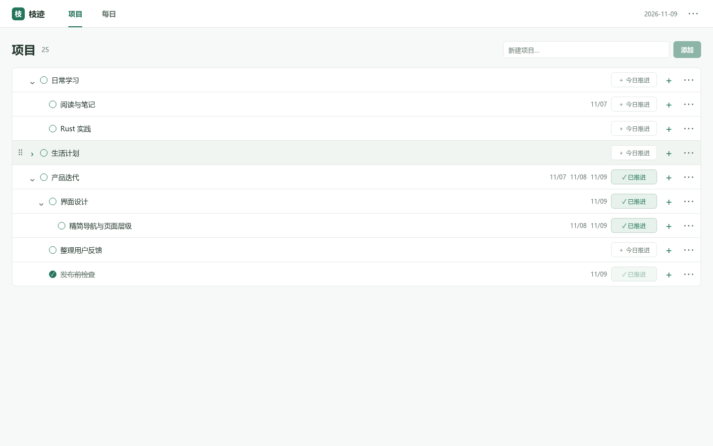
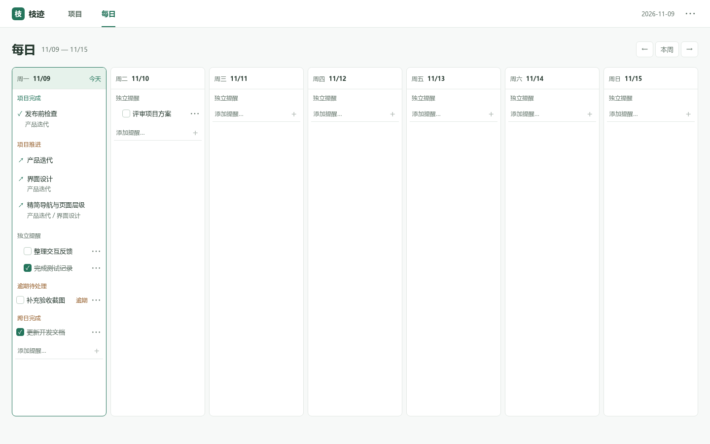

# 枝迹（BranchTrace）

枝迹是一个离线优先的树形项目管理与每日行动记录桌面应用，使用 Tauri 2、React、TypeScript、TanStack Query、Rust、rusqlite 和 SQLite。

| project-view | daily-view |
| --- | --- |
|  |  |


## 开发

```bash
pnpm install
pnpm dev
```

开发浏览器页面会使用本地演示数据；通过 Tauri 启动时，前端会调用 Rust Commands 并将 SQLite 保存到操作系统的应用数据目录。

## 构建

```bash
pnpm build
pnpm tauri dev
pnpm tauri build
```

Linux 构建需要 Tauri 2 的系统依赖，包括 WebKitGTK、GTK 3 和 librsvg；Windows 与 macOS 请按 Tauri 2 官方前置依赖安装 Rust 和平台工具链。

## 后端结构

- `src-tauri/src/models.rs`：DTO、错误、数据库操作消息。
- `src-tauri/src/db.rs`：唯一 SQLite 连接的数据库工作线程、迁移、事务和业务操作。
- `src-tauri/src/lib.rs`：Tauri Commands、应用数据目录和生命周期。
- `src-tauri/migrations/001_initial.sql`：SQLite v1 初始化迁移。

所有业务写入都经过 Rust 的状态、日期、树关系和版本校验。React 不直接访问 SQLite。

## 验证

```bash
./node_modules/.bin/tsc
./node_modules/.bin/vite build
node --test tests/*.test.mjs
cd src-tauri
cargo fmt --all -- --check
cargo test
```

移动位置选择器的回归测试使用 Node.js 24 内置的 TypeScript 支持，无需额外测试依赖。

核心需求与验收边界见 `docs/01_MVP_需求规格.md`，API 契约见 `docs/03_Rust_API_设计.md`，开发阶段与交付出口见 `docs/develop-plan.md`。
